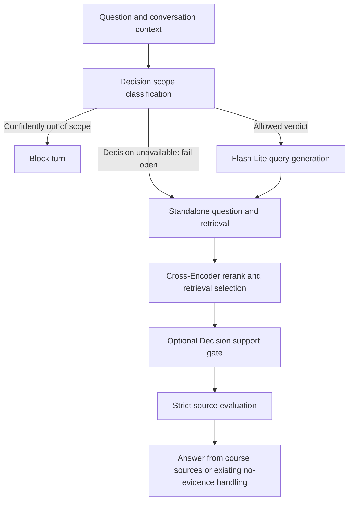

# Gemini Decision scope classification and rerank gate

Implementation branch: `features/Implementation_SwitchToGeminiDecision1`.
Documentation branch: `features/Design_SwitchToGeminiDecision1`.
The backend is based on main commit `4919bea`, which includes the AI-194 exclusive course and consented web lanes.

## Scope classification

`decide_scope()` calls the Gemini Developer Decisions API (`v1beta`) using `DECISION_MODEL=gemini-decision-1`. One request contains a choice question for `core`, `comparison`, `extension`, `logistics`, or `out_of_scope`, and two noul questions for `is_related_tech` and `is_homework_request`. Each noul probability becomes true at 0.5. The winning choice supplies the verdict confidence. Only `out_of_scope` at or above `DECISION_CONFIDENCE_THRESHOLD` (default 0.8) blocks the turn.

`class_scope.yaml` retains the class, syllabus description, recent history, question, snippet, and code context, together with category definitions and examples. Decisions does not generate explanatory text; `reasoning` remains empty.

The scope request rotates eligible keys within its time budget. The Decisions model need not appear in the generative Models API model list. Missing keys, provider errors, timeouts, and invalid responses fail open. There is no scope fallback model.

## Query generation and current callers

After a nonblocking verdict, a separate call to `SCOPE_QUERY_MODEL` (default `models/gemini-3.5-flash-lite`) generates `external_search_query` and `search_query_en` within the remaining scope budget. It uses the existing generative gateway. If it fails, the verdict remains available and the query fields stay empty. Admin retrieval calls this query generator directly without calling scope classification.

The active AI-194 chat endpoint uses `strict_chat_service`. Its scope helper returns only a boolean. It then retrieves using `standalone_question` without forwarding `search_query_en`. The generated query fields and scope flags are therefore not consumed by this caller; homework handling uses its own patterns. Web search follows its separate consent flow. The legacy chat implementation still consumes query fields for English expansion, web queries, citation selection, and concept tagging. Those contracts remain intact.

The ten-question A/B evaluation bypassed query generation only inside its isolated evaluation process. Application code still generates the two fields. Identical retrieval results in this evaluation do not establish that English expansion has no value when actually connected to retrieval.

## Rerank gate

The course lane now follows this sequence:

The gate runs after retrieval returns its chunks and before strict-source evaluation. It does not replace the Cross-Encoder or reorder the answer context. It selects the highest-scoring chunks for inspection and sends one named noul question per checked chunk in a single Decisions request using the same `DECISION_MODEL` and key transport.

| Setting | Default | Behavior |
|---|---|---|
| `RERANK_DECISION_ENABLED` | `false` | Enables the optional course evidence filter |
| `RERANK_DECISION_TOP_K` | `3` | Maximum number of top-scoring chunks checked |
| `RERANK_DECISION_REJECT_THRESHOLD` | `0.10` | Reject a checked chunk when support probability is **at or below** this value |
| `RERANK_DECISION_TIMEOUT_SECONDS` | `2` | Request time budget |

Support is a probability from 0 to 1; 0.10 corresponds to 10%. Partial, paraphrased, and translated evidence can count as support. Shared keywords alone do not. Unchecked chunks are kept; retained chunks preserve their original reading order. A timeout, provider error, or incomplete/invalid response keeps the entire input list. No fallback model is called. The 0.10 threshold is an initial conservative setting, not a validated production optimum.

The web lane does not run this gate. AI-194 routing, consent, citation logic, and Cross-Encoder scoring remain as implemented in main.

## Upload and ingestion

Document relevance validation, its prompt, and its dedicated tests are removed. Upload and indexing no longer call a model to judge whether a document matches the class topic. File/content validation, authorization, and syllabus/unit constraints remain. The existing `force` argument remains accepted for compatibility. Older failed records keep their stored failure reason and can be retried through the normal flow. The frontend removes relevance warnings and force-confirmation dialogs.

## Evaluation and verification

The following plan and evaluation artifacts are retained in the local `course-qa-workspace/resources/` directory; they are not committed to this repository.

- Plan (`resources/plans/ai-193-gemini-decision-1-plan.md`)
- Eight-question scope latency (`resources/reports/ai-193-latency-evaluation.md`): 8/8 correct before and after; p50 1.96 s to 1.80 s. Excludes retrieval, answers, HTTP, and frontend.
- Rerank gate evaluation (`resources/reports/decision-rerank-gate-evaluation.md`): 8 questions and 32 labelled candidate chunks. Top 3 at 0.10 retained 13/13 useful chunks and 21 total chunks; this is a small fixture, not a production quality estimate.
- Ten-question query-generation A/B (`resources/reports/ai-193-query-generation-ab.md`): both configurations used scope and rerank Decisions. Same ordered chunks in 10/10 pairs, 8/10 answers covering the expected main points in each arm; p50 8.25 s with generation and 7.46 s without. No application behavior was changed by the experiment.

Latest backend verification: `uv run pytest -q` returned 1210 passed, 2 skipped, and 2 failed in 484.18 seconds. Both failures were live embedding calls returning 401 for an invalid API key. No keys were unset and no skips added. `uv run ruff check .` and `git diff --check` passed; the grounding formatting correction also passed its 16 focused tests. The resolved SDK versions are `google-genai 3.6.1` and `langchain-google-genai 4.5.1`.

Evaluation scripts are retained with their reports as local experiment artifacts. Their container fixture and SDK paths describe that run; they are not a standalone production benchmark runner.
